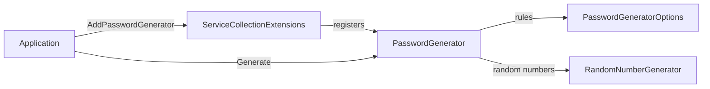

# Architecture

[//]: # "Maintainers: describe the components, as a diagram and a table (Component, Role), and the rules the design
keeps."

How NCode.PasswordGenerator is built. [assurance-case.md](assurance-case.md) explains why the design meets its security
requirements.

## Components

NCode.PasswordGenerator is one library, `src/NCode.PasswordGenerator`, which targets `net10.0`
([ADR-1000](decisions/1000-the-library-targets-net10-only.md)); its only direct package dependencies are
`Microsoft.Extensions.DependencyInjection.Abstractions` and `Microsoft.Extensions.Options`.

| Component | Role |
| --- | --- |
| `IPasswordGenerator` | What applications call: `Generate` overloads that return a `string` or fill the caller's `Span<char>`, with the default options, options passed in, or a callback that adjusts a copy of the defaults. Enumerating it yields `MaxEnumerations` passwords. |
| `PasswordGenerator` | The implementation, and `PasswordGenerator.Default`, a shared instance with the default options. It places each character class's minimum count, fills the rest from the allowed character set, shuffles the result, and repeats until `PasswordGeneratorOptions.IsValid` accepts it or `MaxAttempts` runs out. |
| `PasswordGeneratorOptions` | The rules: the length range, the minimum count of lowercase, uppercase, numeric and special characters, the special characters, the longest run of identical characters, `MaxAttempts` and `MaxEnumerations`. `IsValid` checks a password against them. |
| `ServiceCollectionExtensions` | `AddPasswordGenerator`, which registers `PasswordGenerator` as the singleton `IPasswordGenerator` and configures its options through `Microsoft.Extensions.Options`. |
| `RandomNumberGenerator` | The platform's cryptographically secure random number generator, `System.Security.Cryptography.RandomNumberGenerator`: the only source of a password's length, characters and order. |

## Design Rules

- Decisions the design rests on are recorded in [decisions/](decisions/README.md).
- Every random choice goes through `RandomNumberGenerator`, and a password is returned only after
  `PasswordGeneratorOptions.IsValid` accepts it, except the empty string a length of 0 yields
  ([assurance-case.md](assurance-case.md#security-requirements)).
- Warnings are errors ([ADR-0100](decisions/project-template/0100-warnings-are-errors-in-every-project.md)), and
  disallowed APIs are banned at build time
  ([ADR-0102](decisions/project-template/0102-disallowed-apis-are-banned-at-build-time.md)).
- The public API is tracked and evolves compatibly
  ([ADR-0131](decisions/project-template/0131-public-api-is-tracked-and-evolves-compatibly.md)), and each package is
  validated against the last published package
  ([ADR-0147](decisions/project-template/0147-packages-are-validated-against-the-last-published-package.md)).

## Build and Release

CI runs the project's commands on every pull request (`.github/workflows/ci.yml`). Releases are tagged when
`AGENTS.md`'s Landing section sets `release: tag`, and published too with `tag+release`, as
[ADR-0016](decisions/project-template/0016-releases-are-tagged-and-published-when-their-pull-request-merges.md) records.
The project's own workflow, `.github/workflows/main.yml`, publishes the packages to nuget.org.
